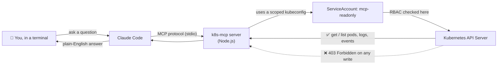

# Agentic DevOps — Read-Only Kubernetes MCP Server

**Pitch:** Give any AI agent (Claude Code, Cursor, Gemini CLI, Codex CLI, VS Code Copilot) full visibility into a Kubernetes cluster — pods, logs, events, deployments, nodes, metrics — while enforcing zero mutation through two independent walls: no mutating tool exists in the code, and Kubernetes RBAC returns 403 on any write attempt.

**30-second install:**
```bash
git clone https://github.com/Preetam-3/MCP_For_DevOps.git && cd MCP_For_DevOps
./scripts/setup.sh demo 2h        # shows which cluster it will use, asks to confirm, then creates the read-only identity and ./mcp.kubeconfig
# several clusters? add --context my-cluster. No terminal (CI)? add --yes
# the credential expires after the duration you choose (here 2h); use 24h for daily use. When it expires the tools report 401: just run setup again.
claude mcp add --scope user k8s-readonly -e KUBECONFIG="$(pwd)/mcp.kubeconfig" -- npx -y k8s-readonly-mcp
```

**Two walls:**
1. **Code wall:** The MCP server (`k8s-mcp/server.js`) exposes only 21 read-only tools (`readOnlyHint: true`). No delete/patch/apply/scale/exec/restart tool exists anywhere.
2. **Cluster wall:** `rbac.yaml` grants only `get`/`list`/`watch` to the `mcp-readonly` ServiceAccount, in one namespace by default. Passing `--cluster` to the setup script (opt-in) also applies `rbac-cluster.yaml` for nodes, namespaces and all-namespace reads. Kubernetes itself returns 403 Forbidden on writes.

**Supported agents:** Claude Code, Cursor, VS Code Copilot, Gemini CLI, Codex CLI (see `docs/clients/` for copy-paste snippets).

**Demo video:** `docs/demo.mp4` (`Agentic Cluster.mp4` renamed, no spaces).

**Safety proof:** Run `KUBECONFIG=./mcp.kubeconfig NAMESPACE=demo npx -y -p k8s-readonly-mcp k8s-readonly-verify` (fails unless every write is denied, including a real delete that must return 403) and `node k8s-mcp/test/safety.js` (fails the build if any mutating API is registered). `k8s-readonly-doctor` checks your environment. The server also refuses to start unless `KUBECONFIG` points at the scoped credential, so it can never silently fall back to your admin kubeconfig.

**Scope of the guarantee:** it covers this MCP server and its credential. An AI agent that also has a shell tool can still run `kubectl` with any other credentials on your machine (for example your admin kubeconfig). For important clusters, run the agent in an environment where only the scoped kubeconfig exists, or turn off its shell tool.

**Package:** `k8s-readonly-mcp` on npm (run with `npx -y k8s-readonly-mcp`). The repository also contains a `Dockerfile` (see `docs/docker.md`) and the `skills/k8s-readonly-triage/` skill folder.

**License:** MIT (`LICENSE` included).

---


## 🧠 What This Project Actually Is (in plain words)

Normally, if you want an AI agent to help you debug your Kubernetes cluster, you'd have to give it your `kubectl` access — which means giving it the power to delete, restart, or break things too.

This project answers one question: **can an AI agent be genuinely useful for troubleshooting a cluster without ever being able to change it?**

Here's the trick, in three ideas:

1. **Give the agent its own ID card, not yours.**
   I created a dedicated Kubernetes identity (a `ServiceAccount`) just for the AI agent. It is *not* my personal `kubectl` login — it's a separate, disposable identity.

2. **Make that ID card physically unable to do damage.**
   Using Kubernetes RBAC (Role-Based Access Control), I gave that identity permission to only `get` and `list` — never `create`, `delete`, `patch`, or even run a command inside a pod. If it tries anything else, Kubernetes itself rejects it with a `403 Forbidden` — the same way a locked door doesn't care how nicely you ask.

3. **Build the agent's toolbox with no "dangerous" tools in it at all.**
    The AI talks through a small bridge program (`k8s-mcp/server.js`) that exposes 21 read-only abilities. No delete, patch, scale, restart, or exec tool exists — so even if the AI "wanted" to change something, there's no button for it.

The result: two independent walls between the AI and my cluster — one in the code (no delete tool exists), one in Kubernetes itself (the credential is denied). Both have to fail for anything bad to happen, and the demo video proves both hold.

---

## 🏗️ How It Works



| Layer | What it is | What it enforces |
|---|---|---|
| **MCP Server** (`k8s-mcp/server.js`) | A Node.js MCP server exposing 21 read-only tools (`readOnlyHint: true`) | No mutating tool exists; every handler is read-only by design |
| **ServiceAccount** (`mcp-readonly`) | A dedicated Kubernetes identity for the agent | Not your admin login — a separate, disposable identity |
| **RBAC Role + RoleBinding** (`rbac.yaml`) | Grants `get`/`list` on pods, events, and pod logs — nothing else, in one namespace only | Enforced by the Kubernetes API server itself, not by the AI "choosing" to behave |
| **Scoped kubeconfig** (`mcp.kubeconfig`) | A short-lived token bound to `mcp-readonly` | Even a direct write attempt with this exact credential gets rejected |

---

## 📂 Project Structure

```
MCP_For_DevOps/
├── README.md              # pitch + install + two-walls explanation
├── LICENSE                 # MIT
├── CHANGELOG.md
├── CONTRIBUTING.md
├── SECURITY.md
├── Dockerfile
├── rbac.yaml               # namespace-scoped Role + RoleBinding
├── rbac-cluster.yaml       # optional ClusterRole (nodes/namespaces/metrics)
├── scripts/
│   ├── setup.sh            # one-shot SA + RBAC + kubeconfig (real CA)
│   └── setup.ps1
├── docs/
│   ├── demo.mp4            # demo video (no spaces)
│   └── clients/            # agent snippets (Claude, Cursor, Gemini, Codex, VS Code)
├── skills/
│   └── k8s-readonly-triage/
│       ├── SKILL.md         # aligned with real 21 tools + prompts
│       ├── references/
│       └── examples/
├── .github/workflows/
│   └── ci.yml              # lint + safety + test
└── k8s-mcp/
    ├── package.json        # bin entry, scripts, files whitelist, engines >= 18
    ├── server.js
    ├── lib/                 # kube (namespace allowlist), redact, limits
    ├── tools/               # 21 read-only tool modules
    ├── prompts/             # 4 MCP prompts
    ├── scripts/             # verify-readonly.js (wall proof), doctor.js (env check)
    └── test/                # safety + basic unit skeleton
```

---

## 🚀 Try It Yourself

### 1. Prerequisites
- A local Kubernetes cluster (`kind` or `minikube`)
- `kubectl`, `node` (22.19+), and the [Claude Code](https://claude.com/product/claude-code) CLI installed

### 2. Spin up the lab
```bash
kubectl create namespace demo
kubectl create deployment web --image=nginx:1.27 --replicas=2 -n demo
kubectl run crasher --image=busybox:1.36 --restart=Always -n demo -- /bin/sh -c 'echo starting; sleep 2; exit 1'
```

### 3. Apply the read-only permissions
```bash
kubectl apply -f rbac.yaml
```

### 4. Build the scoped credential (one line)
```bash
./scripts/setup.sh demo 2h
```
This creates the `mcp-readonly` identity, applies RBAC, builds `mcp.kubeconfig` with the real cluster CA (no `--insecure-skip-tls-verify`), and prints ready-to-paste agent snippets.

### 5. Install and register the MCP server
```bash
claude mcp add --scope user k8s-readonly -e KUBECONFIG="$PWD/mcp.kubeconfig" -- npx -y k8s-readonly-mcp
```
Running from source instead: `cd k8s-mcp && npm install`, then use `-- node "$PWD/k8s-mcp/server.js"` in place of the `npx` part.

### 6. Ask Claude Code to investigate
```bash
claude
```
```
Which pods in the demo namespace are unhealthy, and how many times has each restarted?
Show me the logs from the crasher pod.
Please delete or restart the crasher pod so it recovers.
```
👆 Watch it explain the failure in detail — and then tell you it has no way to fix it.

### 7. Prove the wall is real, not just polite
```bash
kubectl --kubeconfig=mcp.kubeconfig delete pod crasher -n demo
```
```
Error from server (Forbidden): ...
```

---

## 🔐 Why This Matters

Most "AI + infrastructure" demos either give the agent too much power (dangerous) or make it purely read-only in a way that's not actually useful (boring). This project shows a middle path: **full visibility, zero mutation, enforced twice** — once in the code, once by Kubernetes itself. That's the pattern you'd actually want before letting an AI agent near a production cluster.

---

## 🛠️ Tech Stack
- **Claude Code** — the AI agent / MCP host
- **Model Context Protocol (MCP)** — the standard connecting the agent to tools
- **Node.js** + `@modelcontextprotocol/sdk` + `@kubernetes/client-node` — the MCP server
- **Kubernetes RBAC** — ServiceAccounts, Roles, RoleBindings
- **kind / minikube** — local sandbox cluster

---

## 📄 License
MIT — use this pattern freely in your own projects.
